# Do You Really Know Forsyth? — one image, three registries

A React + Express quiz app, containerized from scratch and shipped as **one immutable image to Docker Hub, Azure Container Registry (ACR) and Amazon ECR**. The manifest digest is the same in all three registries.

This README is a runbook. It covers what was built, how it was verified, and why each decision was made. Every number here comes from the commands and screenshots below.

| | v0 (inherited) | 1.0.0 | **1.1.0 (current)** |
|---|---|---|---|
| Runtime base | `node:20-slim` (EOL) | `node:24-slim` | **`gcr.io/distroless/nodejs24-debian13:nonroot`** |
| Image size (disk / compressed) | 759 MB / 144 MB | 335 MB / 81.7 MB | **219 MB / 56.2 MB** |
| `node_modules` in runtime | yes, including dev deps | none | **none** |
| Runs as | root | `node` (UID 1000) | **`nonroot` (UID 65532)** |
| Shell in container | yes | yes | **none** |
| `docker stop` | — | 10.2 s, exit 137 (SIGKILL) → fixed, 0.2 s, exit 0 | **0.2 s, exit 0** |
| CRITICAL / HIGH CVEs (ECR basic scan) | — | 7 / 15 | **0 / 0** |
| CRITICAL / HIGH CVEs (Trivy 0.58.1) | — | 4 / 62 | **0 / 0** |

```
                      docker build (once)
                             │
                 do-you-really-know-forsyth:1.1.0
                 index sha256:09d4b7f4…a0f4af
            ┌────────────────┼─────────────────┐
            ▼                ▼                 ▼
       Docker Hub       Azure ACR          Amazon ECR
  forsythfamous/…   acrforsythdykf…   <acct>.dkr.ecr.eu-north-1…
     (public)       Basic, Entra ID     IMMUTABLE tags,
                    auth, admin off     scan on push
```

**Pull it:**
```bash
docker pull forsythfamous/do-you-really-know-forsyth:1.1.0
docker run -d -p 3000:3000 -e GEMINI_API_KEY=<optional> forsythfamous/do-you-really-know-forsyth:1.1.0
curl localhost:3000/api/health   # {"status":"ok","geminiConfigured":false}
```

---

## Contents
1. [Starting point](#1-starting-point)
2. [Build context: `.dockerignore`](#2-build-context-dockerignore)
3. [Removing `node_modules` from the runtime](#3-removing-node_modules-from-the-runtime)
4. [Multi-stage Dockerfile](#4-multi-stage-dockerfile)
5. [Graceful shutdown: the PID 1 problem](#5-graceful-shutdown-the-pid-1-problem)
6. [Versioning and tagging](#6-versioning-and-tagging)
7. [Docker Hub](#7-docker-hub)
8. [Azure Container Registry](#8-azure-container-registry)
9. [Amazon ECR](#9-amazon-ecr)
10. [CVE scan → distroless → 1.1.0](#10-cve-scan--distroless--110)
11. [Verifying one digest everywhere](#11-verifying-one-digest-everywhere)
12. [Security decisions](#12-security-decisions)
13. [Cost and cleanup](#13-cost-and-cleanup)
14. [Known limits and next steps](#14-known-limits-and-next-steps)

---

## 1. Starting point

The repo shipped with a working but naive Dockerfile. I removed it on a dedicated branch (`containerize`) and rebuilt from scratch. The old image was kept as the baseline.

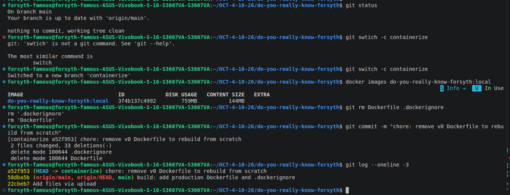

Problems with v0:
- It copied the whole `node_modules` (395 MB, dev dependencies included) into the runtime.
- It ran as root, with no healthcheck.
- It used Node 20, which reached end of life in April 2026.
- It never passed the `VITE_*` build-time variables, so Firebase config could never reach the bundle.

## 2. Build context: `.dockerignore`

`docker build` sends the whole directory to the daemon **before** it reads the Dockerfile. Without an ignore file, `COPY . .` would carry the local `node_modules`, `.git` and any `.env` into an image layer. Anyone who pulls the image can extract layers.

```gitignore
node_modules
dist
dist-server
.env
.env.*
!.env.example
.git
.github
...
```

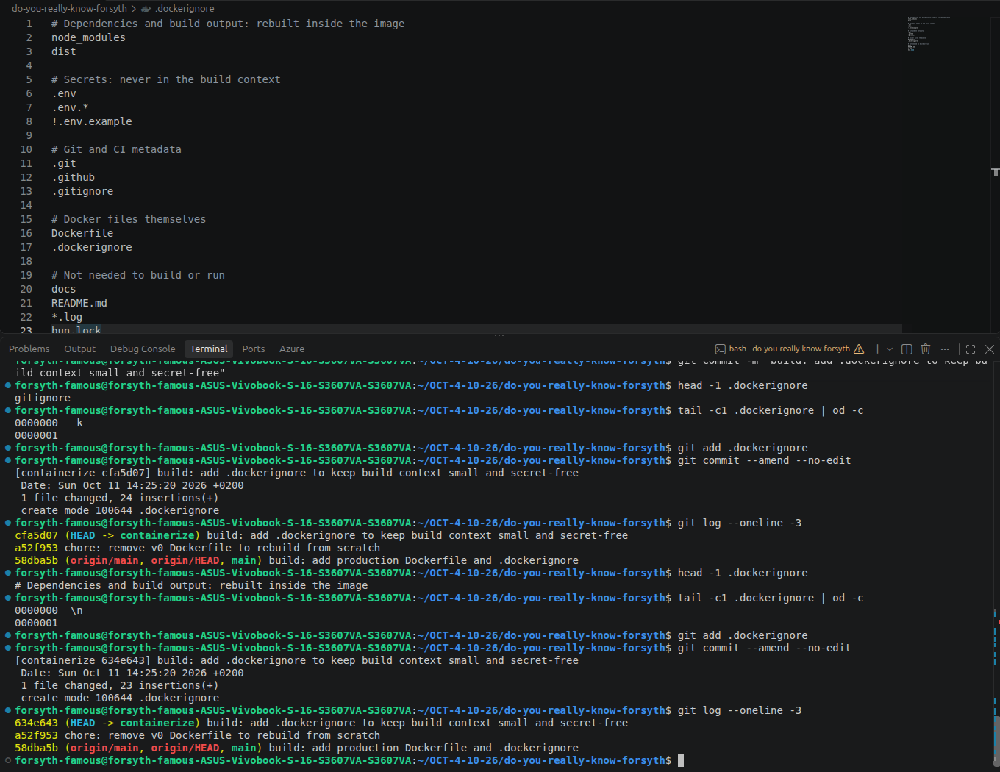

**Result:** the build context is **625 kB**.

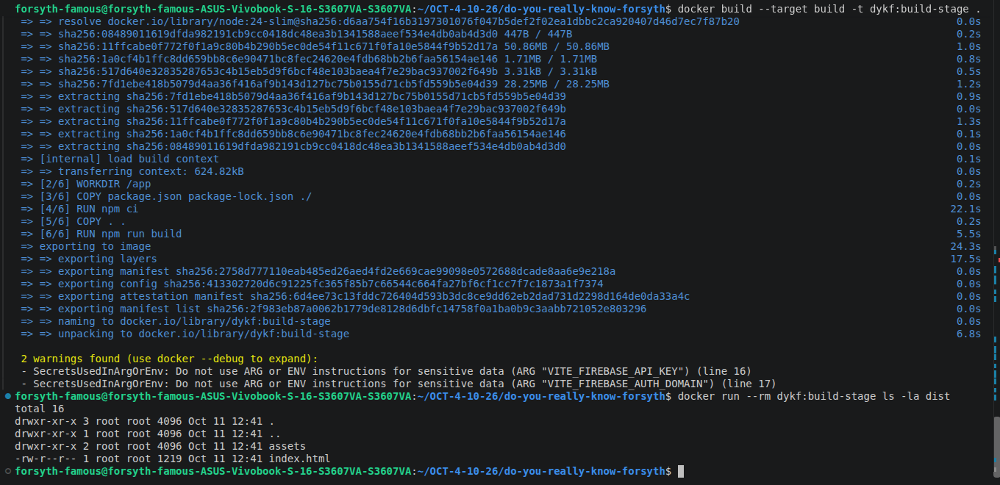

## 3. Removing `node_modules` from the runtime

`react`, `vite`, `firebase` and the rest sit in `dependencies`, not `devDependencies`, so `npm ci --omit=dev` would barely shrink the image. Two code changes remove the need for `node_modules` entirely:

1. **Load Vite only in development.** `server.ts` imported Vite at the top level, which made it a runtime dependency. It's now loaded inside the dev branch:
   ```ts
   if (process.env.NODE_ENV !== 'production') {
     const { createServer: createViteServer } = await import('vite');
     ...
   }
   ```
2. **Bundle the server with esbuild** into one ESM file:
   ```json
   "build:server": "esbuild server.ts --bundle --platform=node --format=esm --target=node24 --external:vite --outfile=dist-server/server.mjs --banner:js=\"import { createRequire } from 'module'; const require = createRequire(import.meta.url);\""
   ```
   - `--external:vite` keeps Vite out of the bundle, since production never loads it.
   - The `createRequire` banner restores `require()` for CommonJS dependencies (Express) inside an ESM bundle.
   - The output goes to `dist-server/`, **not** `dist/`. `dist/` is served publicly by `express.static`, and server code must not be downloadable.

**Proof:** the bundle has no top-level Vite import, and it starts from a directory with no `node_modules` at all:

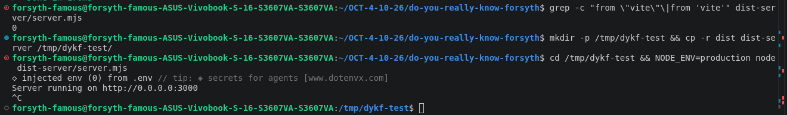

## 4. Multi-stage Dockerfile

```dockerfile
# syntax=docker/dockerfile:1
# check=skip=SecretsUsedInArgOrEnv

FROM node:24-slim AS build
WORKDIR /app
COPY package.json package-lock.json ./
RUN npm ci
COPY . .
ARG VITE_FIREBASE_API_KEY=""
# ...remaining VITE_* args
RUN npm run build && npm run build:server

FROM gcr.io/distroless/nodejs24-debian13:nonroot AS runtime
ENV NODE_ENV=production
WORKDIR /app
COPY --from=build /app/dist ./dist
COPY --from=build /app/dist-server/server.mjs ./server.mjs
EXPOSE 3000
HEALTHCHECK --interval=30s --timeout=3s --start-period=10s --retries=3 \
  CMD ["/nodejs/bin/node", "-e", "fetch('http://127.0.0.1:3000/api/health').then(r=>process.exit(r.ok?0:1)).catch(()=>process.exit(1))"]
CMD ["server.mjs"]
```

| Decision | Reason |
|---|---|
| Manifests copied before source | Layer cache: code changes don't re-run `npm ci`. After a `server.ts` edit, the build log shows `CACHED ... RUN npm ci`. |
| `npm ci` | Installs exactly the lockfile, and fails on drift. Builds are reproducible. |
| `ARG` placed after `npm ci` | Changing a build arg doesn't invalidate the dependency layer. |
| `ARG`, not `ENV`; no real secrets as ARG | ARG values are visible in `docker history`. `GEMINI_API_KEY` is passed at **runtime** only. |
| `check=skip=SecretsUsedInArgOrEnv` | The linter matches any name containing `API_KEY`. A Firebase **web** key is a public project identifier shipped to every browser; Firestore rules protect the data. The skip is documented, not silent. |
| Heavy builder, minimal runtime | Compilers, source and roughly 400 MB of dependencies never leave stage 1. |
| Files root-owned, process non-root | The app can read its code but not overwrite it. |
| `HEALTHCHECK` via `node -e fetch(...)` | There's no `curl` in the runtime, and adding one only for health checks grows the attack surface. Node 24 has `fetch` built in. |
| `127.0.0.1`, not `localhost` | Avoids resolving to IPv6 `::1` while the server listens on IPv4 `0.0.0.0`. |

First hardened build (1.0.0, still on `node:24-slim`): 759 MB → **335 MB**, healthy, non-root, and only two artifacts inside.

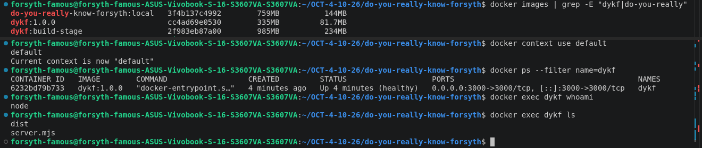

## 5. Graceful shutdown: the PID 1 problem

Measured, not assumed: `docker stop` on 1.0.0 took **10.2 s and exited 137**, meaning Docker gave up and SIGKILLed the process.

**Cause:** exec-form `CMD` makes Node PID 1. Linux doesn't apply default signal actions to PID 1, so a SIGTERM without a handler is **ignored**. On ECS or Kubernetes this means dropped in-flight requests on every deploy.

**Fix** in `server.ts`:
```ts
const shutdown = (signal: string) => {
  console.log(`${signal} received, closing server`);
  server.close(() => process.exit(0));          // stop accepting, finish in-flight
  setTimeout(() => process.exit(1), 8000).unref(); // safety net under Docker's 10 s
};
process.on('SIGTERM', () => shutdown('SIGTERM'));
process.on('SIGINT', () => shutdown('SIGINT'));
```

**Result:** **0.209 s, exit 0**. The build log also shows `CACHED [build 4/6] RUN npm ci`, the layer ordering from section 4 at work.

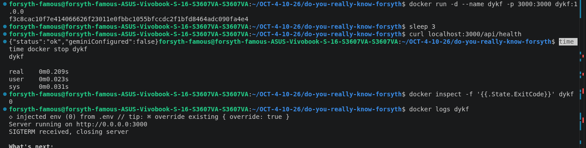

## 6. Versioning and tagging

| Tag | Example | Purpose |
|---|---|---|
| SemVer | `1.1.0` | Release identity, read from `package.json` |
| Git SHA | `sha-a61471a` | Traces any running image back to the exact commit |
| `latest` | — | **Not used.** It moves silently, can't be rolled back to, and means different things to different people. |

Rule: **a pushed tag is never reused.** ECR enforces this with `IMMUTABLE` tags (section 9).

Version and SHA come from the source of truth, never typed by hand. OCI labels embed the provenance in the image:
```bash
SHA=$(git rev-parse --short HEAD)
VERSION=$(node -p "require('./package.json').version")
docker build \
  --label org.opencontainers.image.version=$VERSION \
  --label org.opencontainers.image.revision=$(git rev-parse HEAD) \
  --label org.opencontainers.image.source=https://github.com/forsythfamous/do-you-really-know-forsyth \
  -t do-you-really-know-forsyth:$VERSION \
  -t do-you-really-know-forsyth:sha-$SHA .
```

Two tags, **one image ID**:

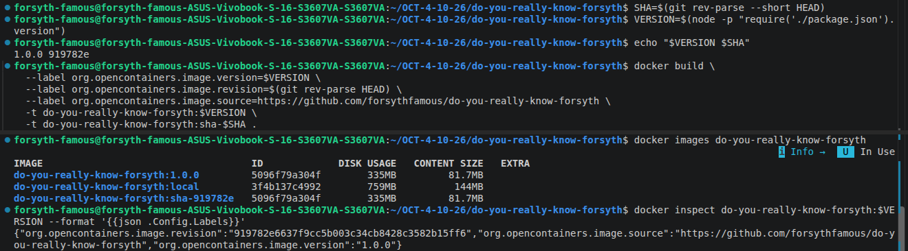

## 7. Docker Hub

- Authentication uses a **scoped, expiring personal access token** (Read & Write), not the account password.
- The credential is stored in the **GNOME keyring** through `docker-credential-secretservice`, not as base64 in `~/.docker/config.json`.

```bash
DH=forsythfamous/do-you-really-know-forsyth
docker tag do-you-really-know-forsyth:1.0.0 $DH:1.0.0
docker tag do-you-really-know-forsyth:1.0.0 $DH:sha-$SHA
docker push $DH:1.0.0
docker push $DH:sha-$SHA
docker buildx imagetools inspect $DH:1.0.0
```

On the second push every layer reports `Layer already exists`. Registries are content-addressed, so a second tag uploads nothing.

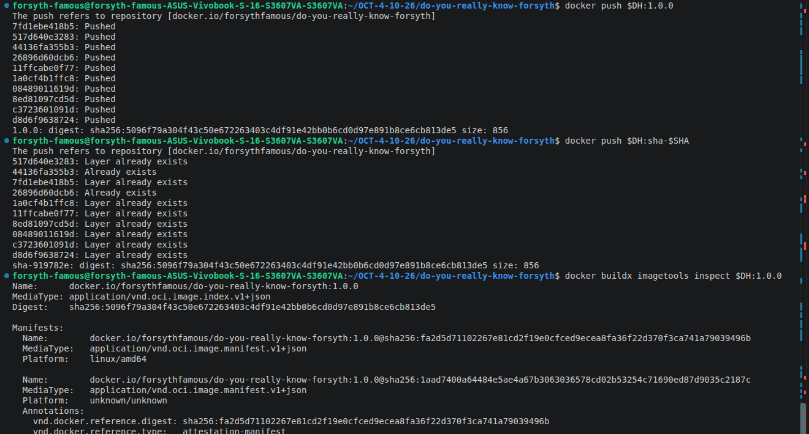

`imagetools inspect` shows an **OCI image index** with 2 entries:
- the `linux/amd64` image;
- an `attestation-manifest` that BuildKit attaches automatically. It records build provenance and is not a second platform.

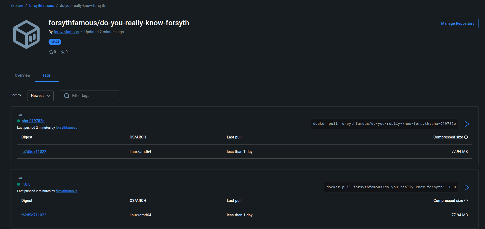

Public access was verified anonymously. The Docker Hub API reports `is_private: false`, and the registry returns HTTP 200 for the `1.1.0` manifest with an anonymous token.

## 8. Azure Container Registry

```bash
RG=rg-dykf-registry; ACR=acrforsythdykf; LOC=polandcentral
az acr check-name -n $ACR -o table
az group create -n $RG -l $LOC --tags project=dykf owner=forsyth
az acr create -n $ACR -g $RG --sku Basic --admin-enabled false
az acr login -n $ACR      # short-lived token (~3 h) from the Entra ID session
```

| Choice | Reason |
|---|---|
| `polandcentral` | Lowest latency from Kraków; data stays in Poland |
| Dedicated resource group plus tags | Cleanup is a single `az group delete`; costs are attributable |
| `--admin-enabled false` | The admin user is one shared static credential for the whole registry. Access goes through Entra ID and RBAC (`AcrPush` / `AcrPull`) instead. |
| Basic SKU | Enough for one repo. Private endpoints and geo-replication are Premium-only, out of scope here. |

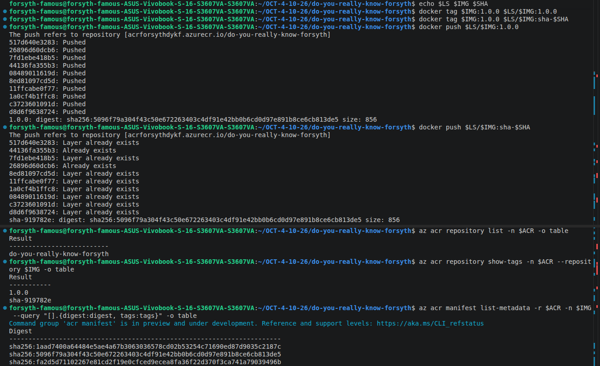

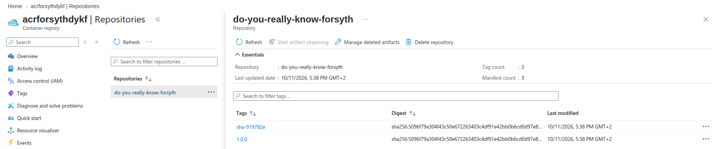

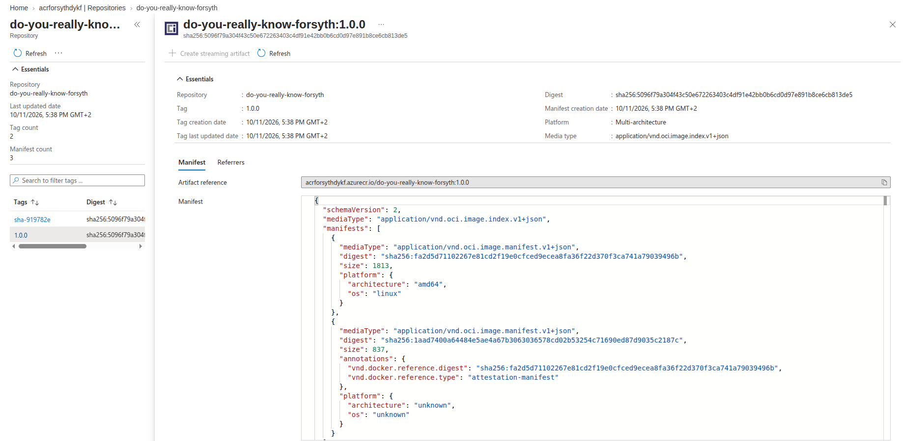

The Portal labels this image **"Multi-architecture"**, and that label is misleading. Azure counts 2 index entries, but the second one is the build attestation (`unknown/unknown`). The image is amd64 only.

## 9. Amazon ECR

The AWS account runs on the **Free plan**. Its guardrail policy (an SCP) allows ECR only in `eu-north-1` (Stockholm), so the repository lives there.

```bash
aws ecr create-repository \
  --repository-name do-you-really-know-forsyth \
  --image-tag-mutability IMMUTABLE \
  --image-scanning-configuration scanOnPush=true \
  --tags Key=project,Value=dykf

aws ecr get-login-password | docker login --username AWS --password-stdin $ECR
```

| Choice | Reason |
|---|---|
| `IMMUTABLE` | The registry **rejects** an overwrite of an existing tag. This enforces the tagging rule; Docker Hub and ACR Basic can't. |
| `scanOnPush=true` | Free basic CVE scan of OS packages on every push |
| `--password-stdin` | The 12-hour token never appears in shell history or the process list |

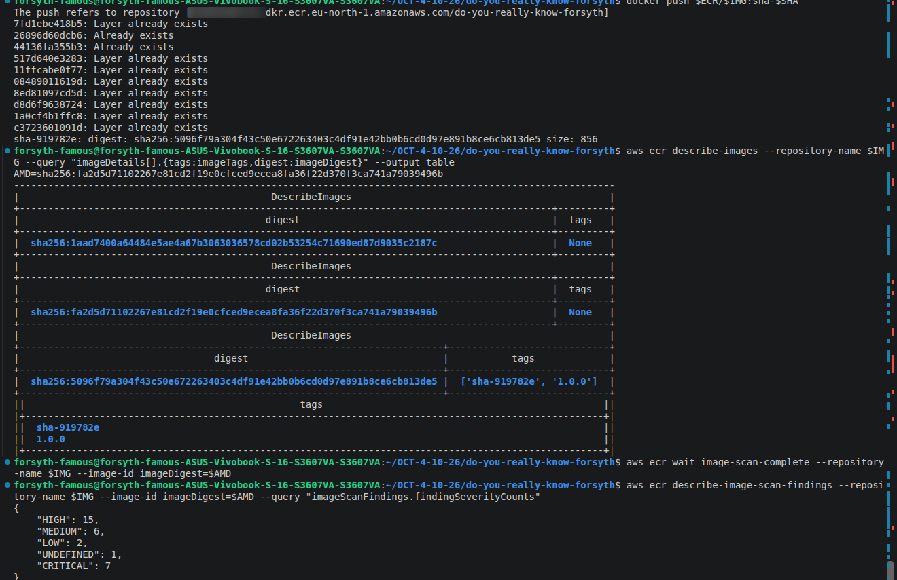

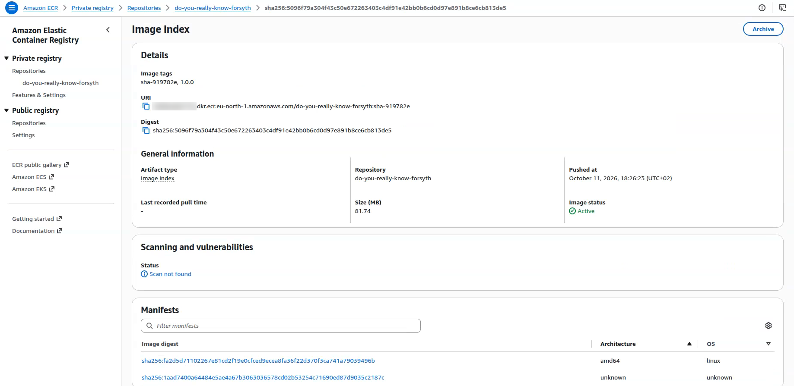

The console shows **"Scan not found"** on the image index, and that's expected. An index is only a list of manifests and holds no filesystem to scan. The scan result belongs to the **amd64 manifest** digest.

## 10. CVE scan → distroless → 1.1.0

The ECR scan of 1.0.0 returned **7 CRITICAL, 15 HIGH**. Grouped by package:

| Package (Debian 12 bookworm) | Critical | High | Used by the app? |
|---|---|---|---|
| `perl` 5.36 | 5 | 7 | No |
| `gnutls28` 3.7.9 | 2 | 3 | No (Node bundles its own OpenSSL) |
| `util-linux` 2.38 | 0 | 5 | No |
| `zlib` 1.2.13 | 0 | 1 | Indirectly |

All findings came from the **base image's OS packages**, not from application code. The fix was to **remove what the app doesn't need** instead of patching it. The runtime moved to `gcr.io/distroless/nodejs24-debian13:nonroot`, which contains Node and its shared libraries only: no shell, no package manager, no perl.

Changes in the runtime stage:
- `FROM gcr.io/distroless/nodejs24-debian13:nonroot`, with the build stage unchanged. Distroless has no npm, so it can't build.
- `USER node` removed, because `:nonroot` already runs as UID 65532.
- `HEALTHCHECK` calls `/nodejs/bin/node` directly, since there's no shell to resolve `PATH`.
- `CMD ["server.mjs"]`, because the image's entrypoint is already `node`.

Verified: healthy, a clean 0.196 s stop, and **no shell to exec into**:

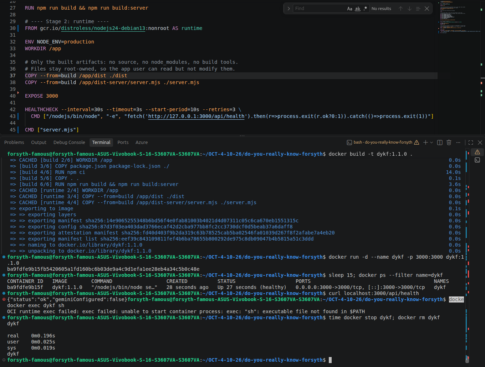

Released as **1.1.0** (commit `a61471a`) and pushed to all three registries in one loop. That loop is the same unit of work a CI job would run:
```bash
for R in $DH $LS $ECR; do
  docker tag do-you-really-know-forsyth:1.1.0 $R:1.1.0
  docker tag do-you-really-know-forsyth:1.1.0 $R:sha-$SHA
  docker push $R:1.1.0
  docker push $R:sha-$SHA
done
```

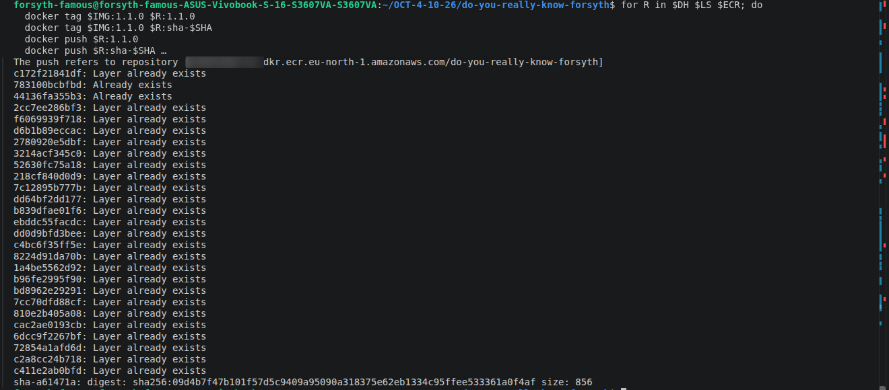

**Cross-checked with a second, independent scanner (Trivy):**

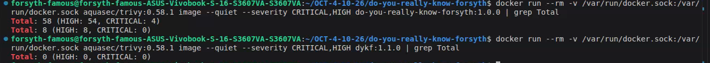

| Scanner | 1.0.0 CRITICAL / HIGH | 1.1.0 CRITICAL / HIGH |
|---|---|---|
| ECR basic scan | 7 / 15 | **0 / 0** |
| Trivy, OS packages | 4 / 54 | **0 / 0** |
| Trivy, npm bundled in base image | 0 / 8 | **0 / 0** (npm isn't in the runtime) |

The two scanners report different totals because they use different vulnerability databases and severity sources. They reach the same verdict.

## 11. Verifying one digest everywhere

```bash
for R in forsythfamous acrforsythdykf.azurecr.io <acct>.dkr.ecr.eu-north-1.amazonaws.com; do
  docker buildx imagetools inspect $R/do-you-really-know-forsyth:1.1.0 | grep ^Digest
done
```

| Registry | `1.1.0` | `sha-a61471a` |
|---|---|---|
| Docker Hub | `sha256:09d4b7f4…a0f4af` | `sha256:09d4b7f4…a0f4af` |
| ACR | `sha256:09d4b7f4…a0f4af` | `sha256:09d4b7f4…a0f4af` |
| ECR | `sha256:09d4b7f4…a0f4af` | `sha256:09d4b7f4…a0f4af` |

Same bytes in every registry. Whatever runs on Azure is provably what runs on AWS.

## 12. Security decisions

- **No secrets in the image:** `.env*` is excluded from the build context. `GEMINI_API_KEY` is runtime-only (`-e` / platform secret). The only build args are the public Firebase web config.
- **Least privilege at runtime:** non-root UID 65532, root-owned read-only app files, no shell, no package manager.
- **Registry credentials:**
  - Docker Hub uses a scoped access token, stored in the OS keyring.
  - ACR uses Entra ID tokens, with the admin user disabled.
  - ECR uses 12-hour tokens from IAM.
- **AWS access:** CLI work runs as an IAM admin user, never root. The CLI uses a named profile with a bootstrap access key, which is scheduled for deletion once CI federation is in place (section 14).
- **Supply chain:**
  - Tags are immutable in ECR, and every image carries OCI revision and source labels.
  - BuildKit provenance attestations are attached.
  - Two independent CVE scanners are used.
- **Redaction:** account and subscription IDs are blurred or cropped out of the screenshots.

## 13. Cost and cleanup

| Resource | Cost |
|---|---|
| Docker Hub public repo | Free |
| ACR Basic | About $0.17/day (about $5/month), billed while the registry existed |
| ECR | About $0.01/month of storage, covered by Free-plan credits |
| Scans (ECR basic, Trivy) | Free |

**Status (2026-10-11):** ACR and ECR were torn down after verification, and the AWS bootstrap access key was deleted. Docker Hub remains the public pull source. The screenshots and digest tables above are the record of the ACR and ECR releases.

Teardown commands used:
```bash
az group delete -n rg-dykf-registry --yes          # ACR and everything in the RG
aws ecr delete-repository --repository-name do-you-really-know-forsyth --force --region eu-north-1
aws iam delete-access-key --user-name forsyth-admin --access-key-id <bootstrap key id>
```

## 14. Known limits and next steps

- **amd64 only.** On AWS Graviton (arm64) the image would fail with `exec format error`. Next: `docker buildx build --platform linux/amd64,linux/arm64` into the same index.
- **Pushes are manual.** Next: a GitHub Actions workflow on `v*` tags that builds once and pushes to all three registries.
  - Azure and AWS would use **OIDC federation**: short-lived tokens, no stored cloud keys.
  - Docker Hub would use a scoped access token as a repository secret.
- **Base image pinned by tag, not by digest.** Next: pin `FROM …@sha256:…`, with Dependabot or Renovate opening update PRs.
- **ECR region.** It's set by the Free-plan guardrail (`eu-north-1`). On a paid account it would be `eu-central-1`, alongside the other workloads.

---

Application details (features, Firebase setup, Vercel deployment): [`docs/APP.md`](docs/APP.md), [`docs/FIREBASE_SETUP.md`](docs/FIREBASE_SETUP.md).
